

**POLITECHNIKA OPOLSKA**
**WYDZIAŁ INFORMATYKI**

### Analiza danych przestrzennych

# Program Copernicus - obliczanie NDVI

| Prowadzący: | Autorzy: |
|---|---|
| dr inż. Krzysztof Smykała | Marcel Kowalczyk Jakub Rudnik |

Informatyka
1 rok / II stopień

Rok akademicki 2026/2027

---

## Spis treści

1. [Wstęp teoretyczny](#1-wstęp-teoretyczny)
2. [Cel i zakres pracy](#2-cel-i-zakres-pracy)
3. [Dane źródłowe i obszar badań](#3-dane-źródłowe-i-obszar-badań)
   - 3.1. [Źródło danych i obszar badań](#31-źródło-danych-i-obszar-badań)
   - 3.2. [Wybór i analiza obszaru w Geoportalu](#32-wybór-i-analiza-obszaru-w-geoportalu)
   - 3.3. [Przygotowanie danych do analizy](#33-przygotowanie-danych-do-analizy)
4. [Opracowanie danych w QGIS](#4-opracowanie-danych-w-qgis)
   - 4.1. [Utworzenie projektu w QGIS](#41-utworzenie-projektu-w-qgis)
   - 4.2. [Obliczenie wskaźnika NDVI](#42-obliczenie-wskaźnika-ndvi)
   - 4.3. [Wizualizacja wyników NDVI](#43-wizualizacja-wyników-ndvi)
5. [Opracowanie danych Sentinel-2](#5-opracowanie-danych-sentinel-2)
   - 5.1. [Dane źródłowe i ich wczytanie](#51-dane-źródłowe-i-ich-wczytanie)
   - 5.2. [Obliczenie wskaźnika NDVI](#52-obliczenie-wskaźnika-ndvi)
   - 5.3. [Histogram i wizualizacja wyników](#53-histogram-i-wizualizacja-wyników)
6. [Wyniki i interpretacja](#6-wyniki-i-interpretacja)
7. [Porównanie danych Sentinel-2 i Geoportalu](#7-porównanie-danych-sentinel-2-i-geoportalu)
   - 7.1. [Charakterystyka danych](#71-charakterystyka-danych)
   - 7.2. [Porównanie histogramów NDVI](#72-porównanie-histogramów-ndvi)
   - 7.3. [Przydatność danych](#73-przydatność-danych)
8. [Wnioski końcowe](#8-wnioski-końcowe)
9. [Bibliografia](#9-bibliografia)

---

## 1. Wstęp teoretyczny

NDVI, czyli Normalized Difference Vegetation Index [1], jest jednym z podstawowych i najczęściej stosowanych wskaźników wykorzystywanych w teledetekcji do oceny kondycji i intensywności roślinności. Wskaźnik ten opiera się na analizie odbicia promieniowania elektromagnetycznego przez rośliny w dwóch zakresach spektralnych: w czerwieni oraz w bliskiej podczerwieni. Wzór na NDVI ma postać:

$$
NDVI = \frac{NIR - RED}{NIR + RED} \tag{1}
$$

gdzie:

- $NIR$ – pasmo bliskiej podczerwieni,
- $RED$ – pasmo czerwone.

Roślinność zdrowa i dobrze rozwinięta silnie odbija promieniowanie w zakresie bliskiej podczerwieni, natomiast stosunkowo słabo odbija promieniowanie czerwone. Z tego względu różnica między tymi pasmami jest duża, a wartość NDVI osiąga wysokie wartości dodatnie. Im zdrowsza i gęstsza roślinność, tym wyższy zazwyczaj jest wskaźnik NDVI. Interpretacja wartości NDVI przedstawia się następująco:

- wartości bliskie 1 oznaczają bardzo dobrą, gęstą roślinność,
- wartości pośrednie wskazują na umiarkowane pokrycie roślinne lub obszary mieszane,
- wartości bliskie 0 oznaczają tereny ubogie w roślinność, np. zabudowę, gołą glebę lub drogi,
- wartości ujemne mogą wskazywać na wodę, cienie, chmury lub inne obiekty pozbawione roślinności.

W analizach wizualnych bardzo pomocna jest również kompozycja CIR (ang. *Color Infrared*), czyli obraz w fałszywych barwach. W takiej kompozycji roślinność zwykle przyjmuje barwy czerwone, ponieważ kanał bliskiej podczerwieni prezentowany jest w kanale czerwonym obrazu. Dzięki temu można łatwo odróżnić obszary porośnięte roślinnością od terenów zabudowanych, dróg, wód czy innych elementów środowiska.

Kompozycja CIR nie zastępuje NDVI, ale stanowi bardzo dobre narzędzie pomocnicze. Pozwala szybko ocenić, gdzie występuje intensywna roślinność, a następnie porównać tę obserwację z wynikami numerycznymi uzyskanymi z indeksu NDVI.

## 2. Cel i zakres pracy

Celem ćwiczenia było zapoznanie się z metodą obliczania wskaźnika NDVI na podstawie danych rastrowych udostępnionych w Geoportalu [2]. Analiza została wykonana w programie QGIS [3], z wykorzystaniem danych w kompozycji CIR oraz pasm spektralnych NIR, RED i GREEN. Dodatkowym celem było praktyczne prześledzenie całego procesu analizy teledetekcyjnej, począwszy od wyboru obszaru badań, poprzez przygotowanie danych, aż do uzyskania i interpretacji mapy NDVI.

Ćwiczenie miało również na celu porównanie obrazu CIR z wynikową mapą NDVI, aby lepiej zrozumieć zależności między wizualną prezentacją roślinności a ilościową oceną jej stanu.

Zakres pracy rozszerzono o obliczenie NDVI na podstawie danych satelitarnych Sentinel-2 z programu Copernicus (pasma B08 i B04) oraz o porównanie uzyskanych wyników z wynikami otrzymanymi dla danych z Geoportalu.

## 3. Dane źródłowe i obszar badań

W analizach teledetekcyjnych bardzo duże znaczenie ma właściwy dobór danych źródłowych oraz poprawne zdefiniowanie obszaru badań. Jakość późniejszych wyników zależy nie tylko od samej metody obliczeniowej, ale również od tego, czy wykorzystane dane są odpowiednio przygotowane i czy obejmują teren odpowiadający założeniom ćwiczenia. Z tego względu pierwszy etap pracy polegał na wyborze analizowanego obszaru oraz zapoznaniu się z jego charakterystyką przy użyciu dostępnych warstw w Geoportalu.

W tym rozdziale omówiono źródło danych wykorzystanych do obliczeń, sposób identyfikacji obszaru badań oraz znaczenie kompozycji CIR w procesie wstępnej interpretacji przestrzennej. Opisano również przygotowanie danych do dalszej obróbki, tak aby mogły zostać poprawnie użyte w programie QGIS. Ten etap stanowił podstawę całej analizy, ponieważ umożliwił przejście od oglądu wizualnego do właściwych obliczeń indeksu NDVI.

### 3.1. Źródło danych i obszar badań

W ćwiczeniu wykorzystano dane udostępnione w Geoportalu, obejmujące analizowany obszar: górny fragment miasta Opola. Wybrany teren charakteryzował się zróżnicowanym pokryciem terenu, co umożliwiało porównanie różnych typów powierzchni, takich jak obszary zielone, zabudowane, odkryta gleba oraz elementy liniowe, np. drogi. Do analizy wykorzystano kompozycję CIR oraz pasma spektralne:

- NIR,
- RED,
- GREEN.

W praktyce pasma NIR i RED były niezbędne do obliczenia NDVI, natomiast pasmo GREEN mogło służyć jako dodatkowe wsparcie interpretacyjne przy analizie wizualnej. Dane zostały następnie zaimportowane do środowiska QGIS, gdzie wykonano dalsze przetwarzanie.

### 3.2. Wybór i analiza obszaru w Geoportalu

Geoportal został wykorzystany do lokalizacji i wstępnego rozpoznania obszaru badań. Na podstawie standardowego widoku mapy możliwe było odnalezienie interesującego terenu, określenie jego położenia oraz zapoznanie się z ogólnym układem przestrzennym badanego obszaru. Etap ten stanowił podstawę do dalszych działań, ponieważ pozwolił na dokładne wskazanie miejsca, dla którego następnie wykonano analizę NDVI.

Wykorzystanie mapy w Geoportalu umożliwiło szybkie porównanie badanego obszaru z otoczeniem oraz ocenę jego charakteru przestrzennego. Na tym etapie wykonano zrzut ekranu przedstawiający interfejs Geoportalu wraz z widokiem mapy i zaznaczonym obszarem zainteresowania.

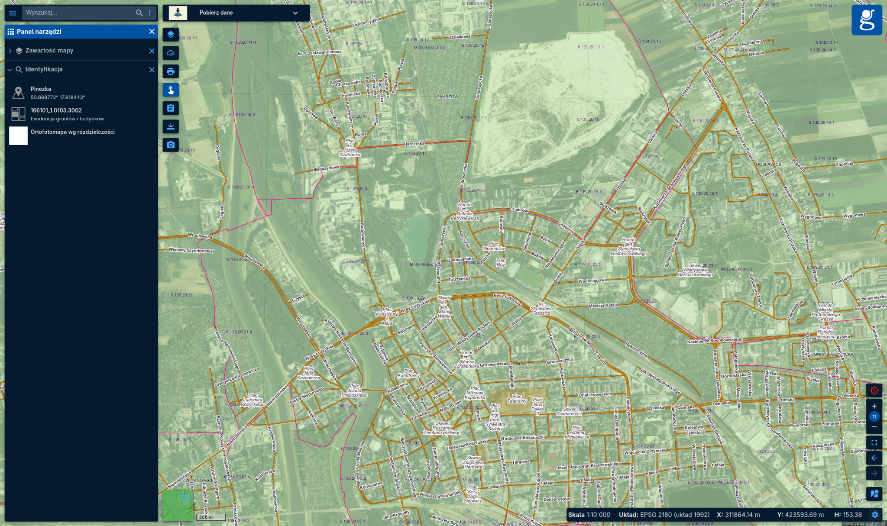

*Rys. 1. Zbliżenie analizowanego obszaru w Geoportalu*

Dalsza analiza została przeprowadzona w programie QGIS, gdzie wykorzystano dane pozwalające na opracowanie kompozycji CIR oraz obliczenie wskaźnika NDVI.

### 3.3. Przygotowanie danych do analizy

Po zidentyfikowaniu obszaru zainteresowania przygotowano dane do dalszej obróbki w programie QGIS. Wykorzystano materiał rastrowy pochodzący z Geoportalu, zawierający kanały spektralne potrzebne do analizy.

W tym etapie ważne było upewnienie się, że dostępne dane mają odpowiednią strukturę i mogą zostać wykorzystane do obliczeń rastrowych. Do właściwego wyznaczenia NDVI konieczne jest użycie pasm odpowiadających za:

- bliską podczerwień (NIR),
- czerwień (RED) [1].

Kanał GREEN nie bierze bezpośrednio udziału we wzorze NDVI, ale może być pomocny przy dodatkowej interpretacji danych oraz przy analizie kompozycji CIR.

## 4. Opracowanie danych w QGIS

Po przygotowaniu danych źródłowych kolejnym etapem było ich opracowanie w programie QGIS. Środowisko to umożliwia pracę na danych rastrowych, wykonywanie obliczeń przy użyciu kalkulatora rastrowego oraz prezentację wyników w sposób czytelny i dostosowany do potrzeb analizy. W tej części ćwiczenia szczególne znaczenie miało poprawne zaimportowanie warstw, nadanie im odpowiednich nazw oraz zachowanie zgodności przestrzennej wszystkich danych.

Rozdział ten obejmuje także właściwe obliczenie NDVI na podstawie wybranych pasm spektralnych, czyli NIR i RED, a następnie nadanie wynikowej warstwie odpowiedniej symboliki. Dzięki temu możliwe było nie tylko uzyskanie wartości liczbowych, ale również stworzenie mapy, która w sposób przejrzysty przedstawia zróżnicowanie pokrycia roślinnego na badanym obszarze. To właśnie na tym etapie surowe dane zostały przekształcone w materiał gotowy do interpretacji.

### 4.1. Utworzenie projektu w QGIS

Uruchomiono program QGIS i utworzono nowy projekt. Wczytanie danych do QGIS było konieczne, aby możliwe było ich dalsze przetwarzanie, obliczenie wskaźnika NDVI oraz odpowiednia wizualizacja wyników.

W pierwszej kolejności dodano mapę podkładową, która ułatwiła orientację przestrzenną i pozwoliła porównać analizowane dane z rzeczywistym układem terenu.

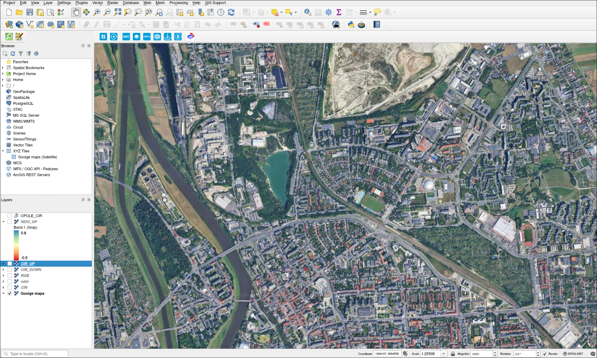

*Rys. 2. Projekt QGIS z dodaną mapą podkładową*

Następnie zaimportowano warstwy rastrowe pochodzące z Geoportalu. W zależności od sposobu przygotowania danych mogły one być oznaczone jako: NIR, RED, GREEN. Dla wygody pracy i czytelności projektu warto było zmienić nazwy warstw na bardziej intuicyjne, tak aby podczas obliczeń nie pomylić pasm.

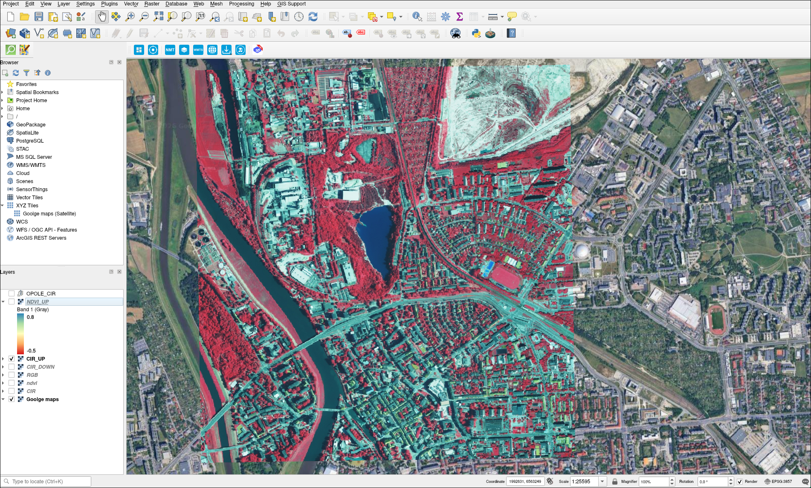

*Rys. 3. Wczytane warstwy NIR, RED i GREEN w QGIS*

Po wczytaniu warstw sprawdzono, czy są one poprawnie nałożone przestrzennie i czy odpowiadają temu samemu obszarowi. Jest to istotne, ponieważ nawet niewielkie przesunięcie między warstwami mogłoby wpłynąć na dokładność końcowych wyników.

### 4.2. Obliczenie wskaźnika NDVI

Po przygotowaniu danych przystąpiono do właściwego obliczenia indeksu NDVI. W tym celu z górnego menu programu QGIS wybrano opcję: **Raster > Raster Calculator** [3]. W oknie kalkulatora rastrowego wpisano formułę ze wzoru (1). W praktyce oznacza to, że dla każdego piksela obrazu obliczana jest wartość oparta na różnicy oraz sumie odbicia w bliskiej podczerwieni i czerwieni.

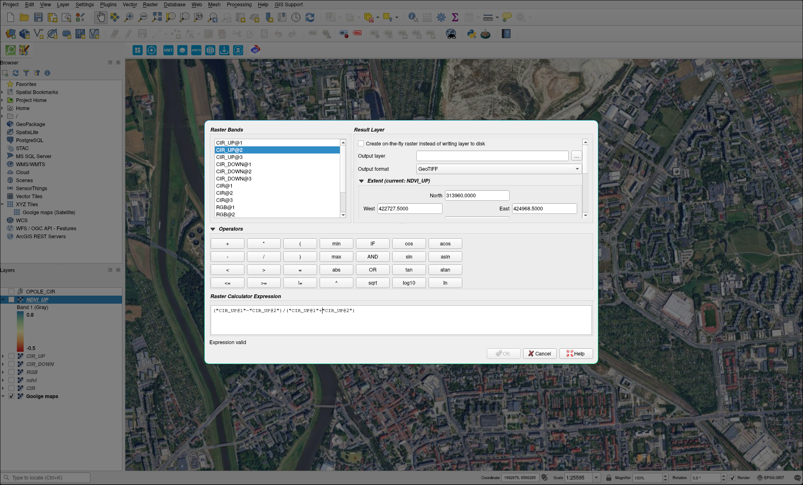

*Rys. 4. Obliczenie wskaźnika NDVI w Raster Calculator*

Po uruchomieniu obliczeń utworzono nową warstwę rastrową, która przedstawiała rozkład wartości NDVI. Dzięki temu możliwe jest numeryczne określenie stopnia pokrycia roślinnego na analizowanym obszarze. Warstwa ta stała się podstawą dalszej interpretacji.

### 4.3. Wizualizacja wyników NDVI

Aby wynik obliczeń był czytelny i łatwiejszy do interpretacji, zmieniono sposób prezentacji warstwy NDVI. We właściwościach warstwy wybrano opcję: **Symbology > Singleband pseudocolor** [3].

Dzięki tej metodzie poszczególnym zakresom wartości NDVI przypisano różne kolory, przyjmując zakres od -0,65 do 0,8. Pozwoliło to wyróżnić obszary o wysokiej, średniej i niskiej intensywności roślinności.

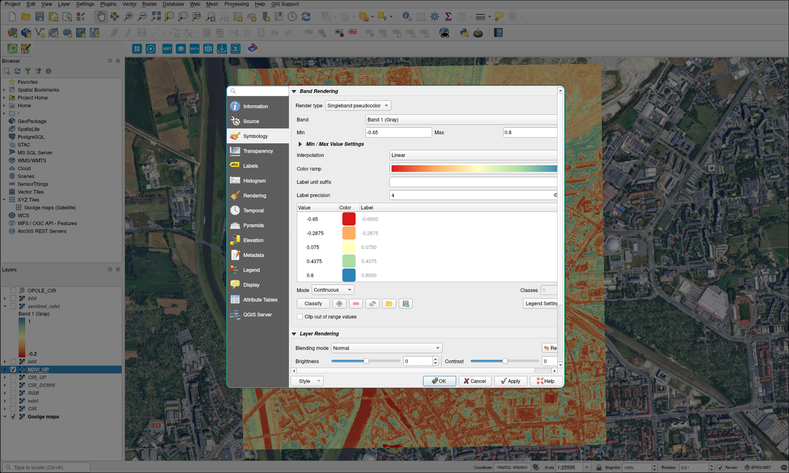

*Rys. 5. Ustawienia symboliki warstwy NDVI*

W typowej skali kolorystycznej wartości wysokie odpowiadają obszarom silnie porośniętym, natomiast wartości niskie oznaczają tereny słabo pokryte roślinnością lub całkowicie jej pozbawione. Taka wizualizacja ułatwia szybkie rozpoznanie struktury przestrzennej badanego obszaru.

Po zastosowaniu odpowiedniej symboliki porównano otrzymaną mapę NDVI z warstwą CIR z Geoportalu. Porównanie to było bardzo pomocne, ponieważ pozwoliło sprawdzić, czy obszary widoczne jako silnie roślinne na obrazie CIR rzeczywiście uzyskały wysokie wartości NDVI.

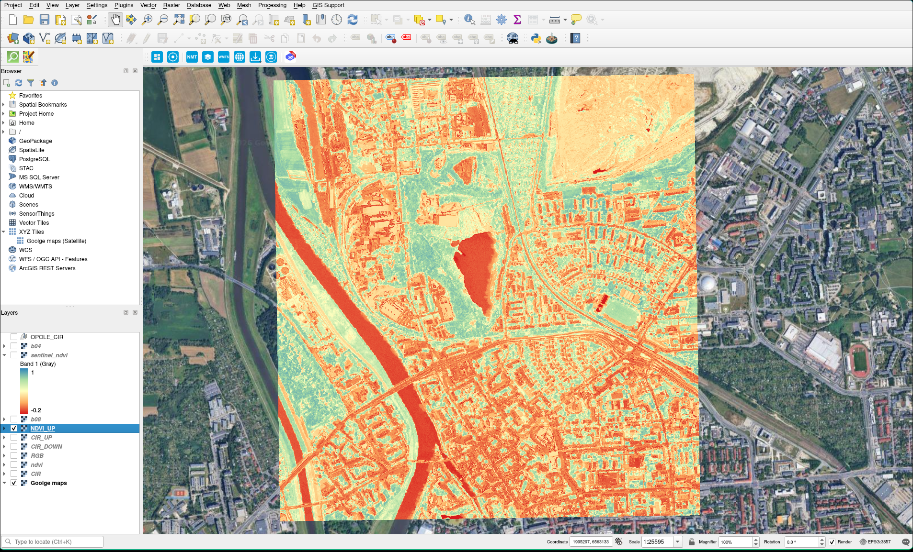

*Rys. 6. Wynikowa mapa NDVI*

## 5. Opracowanie danych Sentinel-2

Kolejnym etapem ćwiczenia było powtórzenie analizy NDVI na danych satelitarnych pochodzących z misji Sentinel-2 programu Copernicus. Obliczenia wykonano w tym samym projekcie QGIS, dzięki czemu wyniki można było bezpośrednio zestawić z mapą NDVI uzyskaną z danych z Geoportalu.

### 5.1. Dane źródłowe i ich wczytanie

Wykorzystano dane Sentinel-2 na poziomie przetworzenia L2A z dnia 28.10.2026 r., pobrane z serwisu Copernicus Browser [4]. Poziom L2A zawiera obrazy po korekcji atmosferycznej, przedstawiające odbicie od powierzchni terenu [5]. Do obliczenia NDVI potrzebne były dwa pasma o rozdzielczości przestrzennej 10 m [5]:

- B08 – bliska podczerwień (NIR, ok. 842 nm),
- B04 – czerwień (RED, ok. 665 nm).

Pobrany obszar obejmuje około 7,4 × 6,8 km (ok. 50 km²), a więc część miasta Opola wraz z otaczającymi ją terenami rolniczymi i leśnymi. Do orientacji przestrzennej ponownie posłużyła mapa podkładowa.

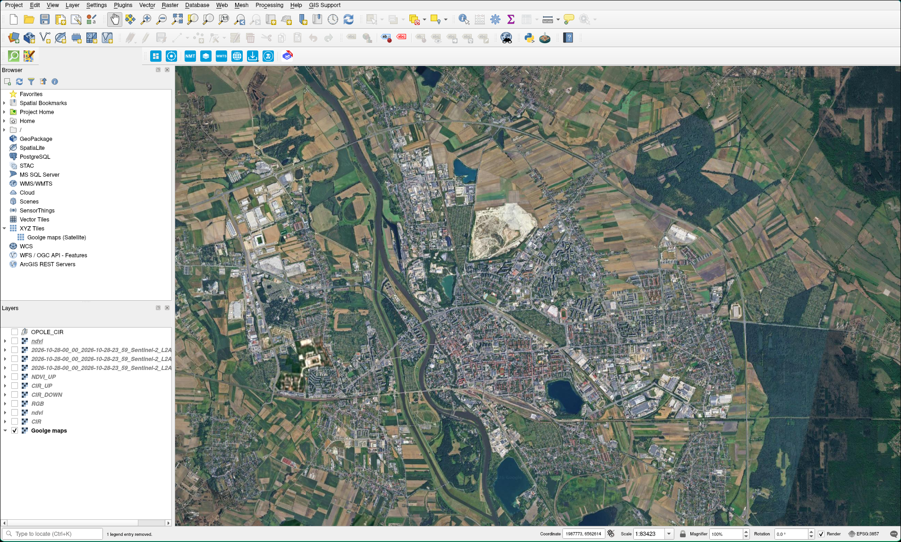

*Rys. 7. Mapa podkładowa analizowanego obszaru w QGIS*

Następnie wczytano oba pasma jako osobne warstwy rastrowe. Na obrazie pasma B08 roślinność jest jasna, a woda niemal czarna. Pasmo B04 jest znacznie ciemniejsze, ponieważ roślinność pochłania promieniowanie czerwone, a jasno wyróżniają się jedynie powierzchnie odkryte, takie jak obszar wyrobiska w północnej części kadru. To właśnie ta różnica między pasmami jest podstawą działania wskaźnika NDVI.

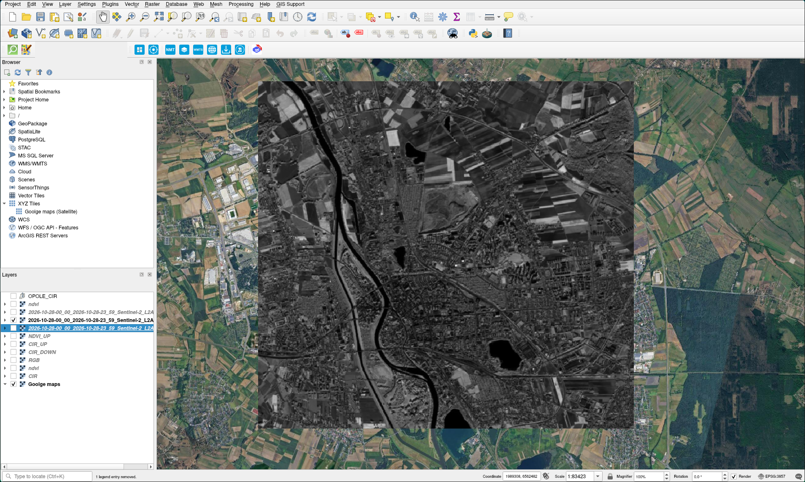

*Rys. 8. Pasmo B08 (NIR) w QGIS*

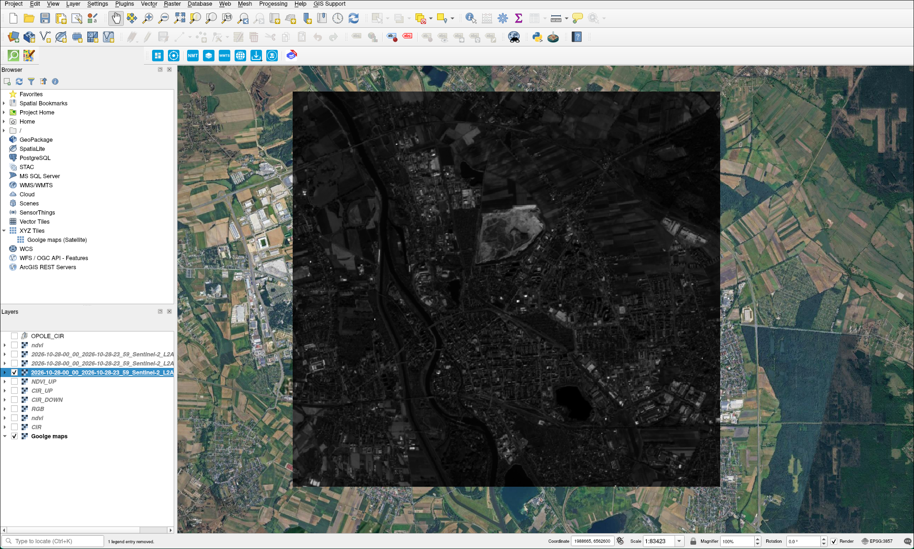

*Rys. 9. Pasmo B04 (RED) w QGIS*

### 5.2. Obliczenie wskaźnika NDVI

Wskaźnik obliczono w narzędziu **Raster > Raster Calculator** [3], podobnie jak w rozdziale 4.2. Zgodnie ze wzorem (1) jako $NIR$ przyjęto pasmo B08, a jako $RED$ pasmo B04. Warstwę wynikową nazwano `ndvi_sentinel`.

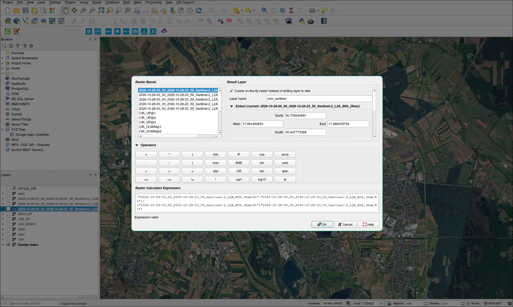

*Rys. 10. Obliczenie wskaźnika NDVI dla danych Sentinel-2 w Raster Calculator*

### 5.3. Histogram i wizualizacja wyników

Przed nadaniem symboliki sprawdzono rozkład wartości na histogramie warstwy. Zdecydowana większość pikseli ma wartości dodatnie: wyraźny wzrost liczebności zaczyna się w okolicy 0, a rozkład kończy się w pobliżu 0,9. Wartości ujemne stanowią jedynie niewielki „ogon”, odpowiadający głównie wodzie.

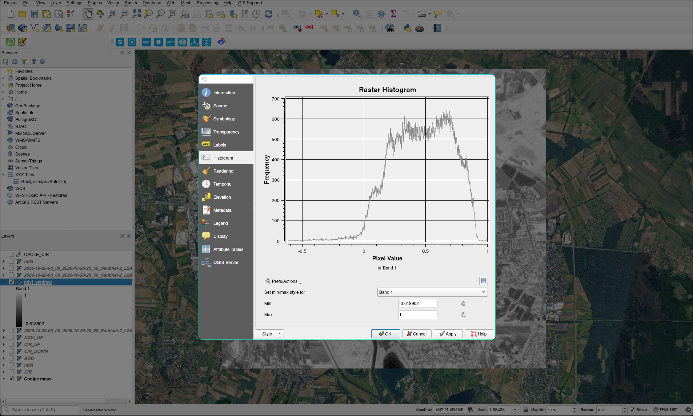

*Rys. 11. Histogram NDVI dla danych Sentinel-2*

Na tej podstawie dla symboliki **Singleband pseudocolor** przyjęto zakres wartości od -0,2 do 1, z paletą przechodzącą od czerwieni przez żółć do błękitu.

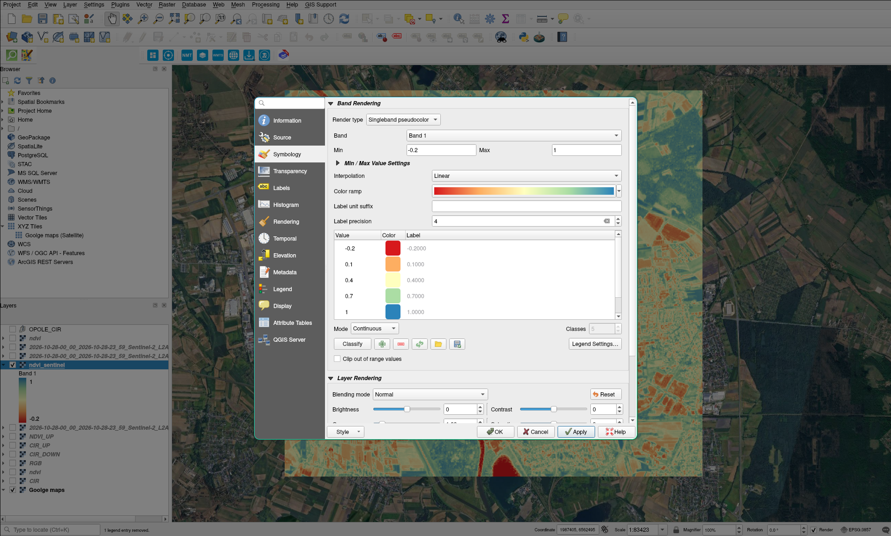

*Rys. 12. Ustawienia symboliki warstwy NDVI dla danych Sentinel-2*

Na mapie wynikowej najniższe wartości (kolor czerwony) przyjmują Odra i zbiorniki wodne. Zabudowa centrum miasta oraz terenów przemysłowych ma barwy pomarańczowe, a najwyższe wartości (kolor niebieski) występują na terenach leśnych i na części pól uprawnych.

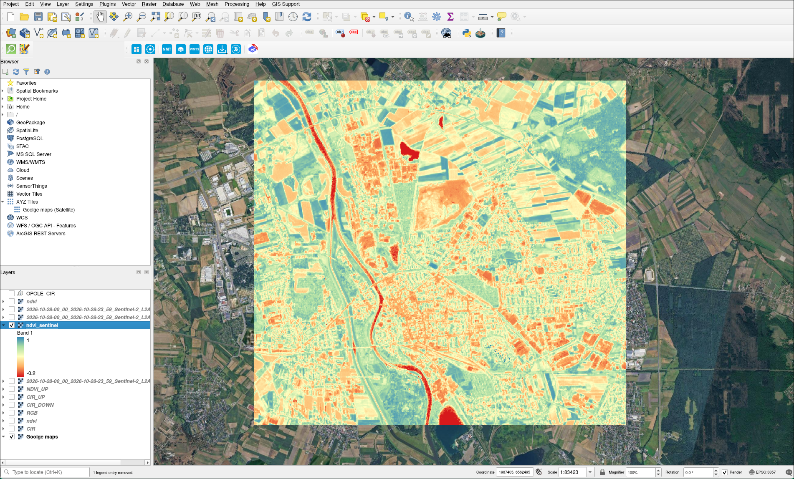

*Rys. 13. Wynikowa mapa NDVI dla danych Sentinel-2*

## 6. Wyniki i interpretacja

Analiza końcowej mapy NDVI wykazała wyraźne zróżnicowanie pokrycia terenu na badanym obszarze. Najwyższe wartości indeksu występowały w miejscach porośniętych roślinnością, takich jak tereny zielone, zadrzewienia, łąki lub inne powierzchnie biologicznie czynne. Tego rodzaju obszary charakteryzują się dużą aktywnością wegetacyjną i dobrą kondycją roślin.

Niższe wartości NDVI obserwowano natomiast na terenach zabudowanych, drogach, placach oraz w miejscach, gdzie roślinność była ograniczona lub nie występowała wcale. W przypadku powierzchni odkrytych, takich jak gleby lub nawierzchnie sztuczne, wskaźnik przyjmował niższe wartości, co jest zgodne z interpretacją teledetekcyjną.

Porównanie mapy NDVI z obrazem CIR pozwoliło potwierdzić poprawność interpretacji. Na obu wizualizacjach obszary porośnięte roślinnością były łatwe do identyfikacji, choć każda z metod prezentowała je w inny sposób. Obraz CIR umożliwiał szybką ocenę wizualną, natomiast NDVI dostarczał bardziej precyzyjnej, ilościowej informacji o stanie roślinności.

## 7. Porównanie danych Sentinel-2 i Geoportalu

Oba zestawy danych pozwalają obliczyć NDVI tym samym wzorem, jednak różnią się sposobem pozyskania i przetworzenia, co bezpośrednio przekłada się na otrzymane wartości.

### 7.1. Charakterystyka danych

| Cecha | Geoportal (CIR) | Sentinel-2 L2A (B08, B04) |
|---|---|---|
| Rodzaj danych | ortofotomapa lotnicza | zobrazowanie satelitarne |
| Postać danych | jeden plik z 3 kanałami (NIR, RED, GREEN) | osobne pliki dla każdego pasma, misja rejestruje łącznie 13 pasm [5] |
| Głębia bitowa | 8 bitów (0–255) | 16 bitów |
| Rozmiar piksela | 0,25 m | 10 m (rozdzielczość natywna pasm), w pobranym rastrze ok. 6,3 × 10 m (0,00009°) |
| Analizowany obszar | ok. 2,2 × 2,3 km | ok. 7,4 × 6,8 km |
| Liczba pikseli całej warstwy NDVI | 84 198 852 (8964 × 9393) | 797 544 (1166 × 684) |
| Liczba pikseli na wspólnym obszarze (zasięg CIR) | 84 198 852 | 85 204 |
| Wartości | po obróbce tonalnej, bez kalibracji do odbicia | odbicie od powierzchni terenu po korekcji atmosferycznej [5] |

Średnie wartości kanałów pokazują istotną różnicę. W użytym arkuszu CIR kanały NIR i RED mają niemal identyczną średnią (ok. 112 i 113), natomiast w danych Sentinel-2 średnia pasma B08 jest około trzykrotnie wyższa niż pasma B04 (ok. 13 300 i 4 500).

### 7.2. Porównanie histogramów NDVI

Histogram NDVI obliczonego z danych CIR jest wyraźnie przesunięty w stronę wartości ujemnych. Rozkład zaczyna się w okolicy -0,6, a jego główna część zaczyna się około -0,5. Widoczne są dwa skupienia wartości: od -0,5 do 0 oraz od 0 do około 0,6.

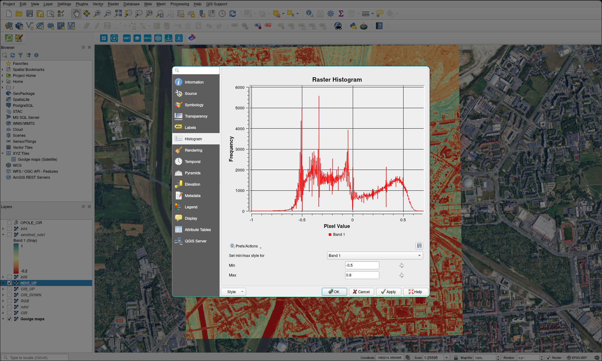

*Rys. 14. Histogram NDVI dla danych CIR z Geoportalu*

Histogram danych Sentinel-2 (Rys. 11) zaczyna się natomiast praktycznie od 0. Ponieważ warstwa Sentinel-2 obejmuje większy teren, do porównania liczbowego wycięto z niej fragment odpowiadający zasięgowi warstwy CIR:

| Statystyka NDVI | CIR | Sentinel-2 (wspólny obszar) | Sentinel-2 (cały obszar) |
|---|---|---|---|
| Średnia | -0,047 | 0,419 | 0,471 |
| Mediana | -0,100 | 0,426 | 0,481 |
| Percentyl 5 | -0,506 | 0,067 | 0,083 |
| Percentyl 95 | 0,496 | 0,760 | 0,828 |
| Udział pikseli < 0 | 60,8% | 1,6% | 1,4% |

Na wspólnym obszarze wartości NDVI z Sentinel-2 są średnio o około 0,46 wyższe niż z CIR. Przesunięcie nie wynika więc z różnicy obszarów. Sprawdzono również na próbce 1000 × 1000 pikseli, że warstwa NDVI z CIR została policzona poprawnie, czyli z kanałów 1 (NIR) i 2 (RED).

NDVI obliczono osobno dla każdego źródła, a pasm B08 i B04 ani kanałów CIR nie przepróbkowywano po pobraniu. Statystyki w tabeli policzono na oryginalnych pikselach: kolumna CIR obejmuje całą warstwę, a kolumna wspólnego obszaru to warstwa Sentinel-2 wycięta do zasięgu CIR. Dopiero do wyznaczenia średniej różnicy i korelacji gotową warstwę NDVI z CIR przepróbkowano z układu EPSG:2180 do siatki Sentinel-2 (EPSG:4326), uśredniając wartości pikseli (metoda `average` w bibliotece rasterio). Porównanie objęło 83 315 pikseli.

Najbardziej prawdopodobną przyczyną jest sposób przygotowania ortofotomapy. Jej kanały są skalowane do 8 bitów i wyrównywane tonalnie pod kątem odbioru wizualnego, przez co relacja NIR do RED nie odpowiada fizycznemu odbiciu. W efekcie zabudowa i drogi, dla których w danych Sentinel-2 NDVI jest dodatnie, w CIR przyjmują wartości ujemne. Część różnicy może też wynikać z innego terminu wykonania zdjęć, ponieważ dane Sentinel-2 pochodzą z końca października.

Współczynnik korelacji między obiema warstwami na wspólnym obszarze wynosi około 0,66. Oba wyniki oddają więc podobny układ przestrzenny, ale wartości nie są zamienne. Progi interpretacyjne podane w rozdziale 1 pasują do danych Sentinel-2, natomiast NDVI z CIR należy traktować raczej jako miarę względną, porównując obszary w obrębie jednego arkusza.

### 7.3. Przydatność danych

**Dane Sentinel-2** dostarczają więcej informacji w sensie radiometrycznym i spektralnym: mają większą głębię bitową, dostęp do kolejnych pasm i wartości odbicia po korekcji atmosferycznej. Obejmują też większy obszar, a wartości NDVI mają zakres zgodny z interpretacją teledetekcyjną. Lepiej nadają się zatem do analiz ilościowych.

**Dane CIR z Geoportalu** są natomiast lepsze do wizualizacji. Piksel 0,25 m pozwala rozróżnić pojedyncze budynki, drogi i drzewa (Rys. 6), które na mapie Sentinel-2 o natywnej rozdzielczości 10 m (Rys. 13) zlewają się w jednolite plamy. Na tym samym obszarze warstwa CIR zawiera około 1000 razy więcej pikseli (84,2 mln wobec ok. 85 tys.).

## 8. Wnioski końcowe

Przeprowadzone ćwiczenie pozwoliło na praktyczne wykorzystanie danych udostępnianych w Geoportalu do obliczenia wskaźnika NDVI w środowisku QGIS. Analiza objęła zarówno wizualną ocenę obszaru w kompozycji CIR, jak i numeryczne przetworzenie pasm spektralnych NIR i RED.

Uzyskane wyniki potwierdziły, że NDVI jest skutecznym narzędziem do oceny stanu roślinności. Dzięki niemu możliwe było wskazanie obszarów o dużej intensywności wegetacji oraz terenów słabiej porośniętych. Dodatkowym atutem analizy było wykorzystanie warstwy CIR, która ułatwiła interpretację przestrzenną i porównanie wyników z obrazem teledetekcyjnym.

Ćwiczenie pokazało również, że połączenie wizualizacji CIR z obliczeniami NDVI stanowi bardzo przydatne podejście w analizie przestrzennej, ponieważ umożliwia zarówno szybkie rozpoznanie pokrycia terenu, jak i bardziej szczegółową ocenę jego kondycji.

Porównanie z danymi Sentinel-2 wykazało, że wynik NDVI silnie zależy od źródła danych. Histogram NDVI z CIR jest przesunięty w stronę wartości ujemnych (główna część rozkładu od około -0,5), a histogram Sentinel-2 zaczyna się w okolicy 0. Dane Sentinel-2 niosą więcej informacji i lepiej nadają się do analiz ilościowych, natomiast dane CIR, dzięki znacznie większej szczegółowości, są lepsze do wizualizacji.

## 9. Bibliografia

1. NASA Earthdata – NDVI, dokumentacja online: <https://www.earthdata.nasa.gov/topics/land-surface/normalized-difference-vegetation-index-ndvi>, dostęp: 20.10.2026.
2. Geoportal, Główny Urząd Geodezji i Kartografii, dokumentacja online: <https://mapy.geoportal.gov.pl/imapnext/pomoc/>, dostęp: 19.10.2026.
3. Dokumentacja QGIS 3.44, QGIS project, dokumentacja online: <https://docs.qgis.org/3.44/pl/docs/>, dostęp: 20.10.2026.
4. Copernicus Browser, Copernicus Data Space Ecosystem, serwis online: <https://browser.dataspace.copernicus.eu/>, dostęp: 01.11.2026.
5. Sentinel-2, Copernicus Data Space Ecosystem, dokumentacja online: <https://documentation.dataspace.copernicus.eu/Data/SentinelMissions/Sentinel2.html>, dostęp: 01.11.2026.
