<div align="center">

**POLITECHNIKA OPOLSKA**
**WYDZIAŁ INFORMATYKI**

### Analiza danych przestrzennych

# GeoPandas i Rasterio: PM2.5 i NDVI w Opolu

</div>

| Prowadzący: | Autorzy: |
|---|---|
| dr inż. Krzysztof Smykała | Marcel Kowalczyk<br>Jakub Rudnik |

<div align="center">

Informatyka
1 rok / II stopień

Rok akademicki 2026/2027

</div>

---

## 1. Cel ćwiczenia

Ćwiczenie miało dwie części. W części A biblioteką GeoPandas [1] przetworzyliśmy plik CSV z odczytami PM2.5, żeby odpowiedzieć na dwa pytania. Które dzielnice Opola mają najgorsze powietrze? Jak wygląda sytuacja przy szkołach podstawowych? W części B biblioteką Rasterio [2] policzyliśmy NDVI ze sceny Sentinel-2 i średnie NDVI w dzielnicach.

Zamiast notatników Jupyter użyliśmy Streamlit [3]. Część A jest w `app.py`, część B w `ndvi_app.py`.

## 2. Dane i środowisko

| Plik | Zawartość |
|---|---|
| `pm25_sensors.csv` | odczyty PM2.5 z czujników (dane syntetyczne, celowo z błędami) |
| `opole_districts.geojson` | granice 29 dzielnic Opola (OpenStreetMap) |
| `opole_schools.geojson` | szkoły podstawowe (OpenStreetMap) |
| `S2_L2A_2026-10-06_B04.tiff` | Sentinel-2, pasmo czerwone (Red) |
| `S2_L2A_2026-10-06_B08.tiff` | Sentinel-2, bliska podczerwień (NIR) |

Dane leżą poza repozytorium, w `../data/lab2-geopandas/`. Uruchomienie:

```bash
cd G.A.S.Z./lab2-geopandas
python -m venv .venv && source .venv/bin/activate
pip install -r requirements.txt
streamlit run app.py        # część A
streamlit run ndvi_app.py   # część B
```

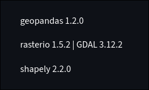

*Rys. 1. Wersje bibliotek: GeoPandas 1.2.0, Rasterio 1.5.2 (GDAL 3.12.2), Shapely 2.2.0*

## 3. Część A: GeoPandas

### A1. Geometria i GeoDataFrame

Z punktu (Rynek) i kwadratu zbudowaliśmy `GeoDataFrame` w EPSG:4326. Shapely przyjmuje współrzędne w kolejności (x, y), czyli najpierw długość, potem szerokość.

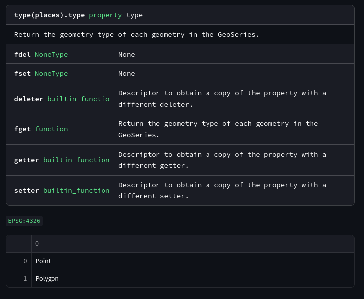

*Rys. 2. CRS = EPSG:4326, typy geometrii Point i Polygon*

### A2. Surowe dane

CSV wczytaliśmy zwykłym pandas i przed obliczeniami przejrzeliśmy `describe()`, `isna()` i `duplicated()`. Plik ma 145 wierszy, 5 duplikatów, 3 braki w `lat` i 4 w `lon`. Minimum `pm25` wynosi -999.

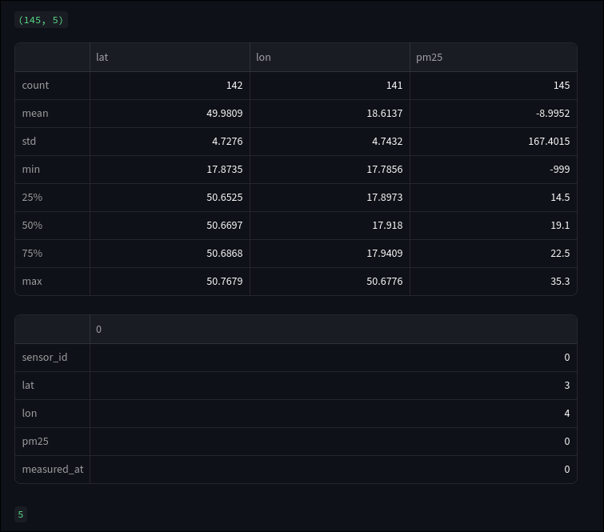

*Rys. 3. Statystyki surowych danych, braki i liczba duplikatów*

> **Minimum `lat` wynosi ok. 17,9, a Opole leży na ok. 50,7°N. Skąd 17,9?**
>
> W trzech wierszach ktoś zamienił kolumny. W `lat` jest długość geograficzna Opola (ok. 17,9°E), w `lon` szerokość. Potwierdza to `max lon` = 50,68, a długość geograficzna w Polsce nie przekracza 24°.

### A3. Czyszczenie

```python
df = raw.drop_duplicates()                                    # 145 -> 140
df = df.dropna(subset=["lat", "lon"])                         # 140 -> 134
swapped = df["lat"].between(14, 24.5) & df["lon"].between(49, 55)
df.loc[swapped, ["lat", "lon"]] = df.loc[swapped, ["lon", "lat"]].to_numpy()   # 3 wiersze
df = df[df["pm25"] >= 0].reset_index(drop=True)               # 134 -> 130
```

Bez `.to_numpy()` pandas dopasowuje kolumny po nazwach i zamiana nic nie zmienia, bez żadnego ostrzeżenia. Po czyszczeniu zostało 130 wierszy, `lat` mieści się w 50,62-50,77, a `pm25` w 9,2-35,3 µg/m³.

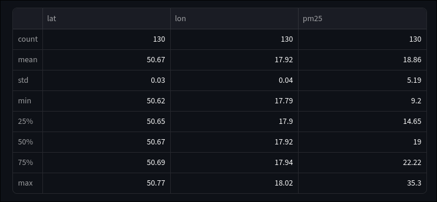

*Rys. 4. Statystyki po czyszczeniu*

> **Dlaczego zamienione współrzędne naprawiliśmy, a wiersze z -999 usunęliśmy?**
>
> W wierszu z zamianą wszystkie wartości są poprawne, tylko w złych kolumnach, więc zamiana je odtwarza. -999 to kod błędu czujnika i pomiaru nie da się odzyskać. Zostawienie go psuje statystyki (średnia surowa wynosi -9,0 µg/m³), a wstawienie średniej byłoby zmyślaniem danych.

### A4. Z tabeli do GeoDataFrame

```python
sensors = gpd.GeoDataFrame(df, geometry=gpd.points_from_xy(df["lon"], df["lat"]), crs="EPSG:4326")
```

`total_bounds` = [17.79, 50.62, 18.02, 50.77], wszystkie punkty leżą w Opolu.

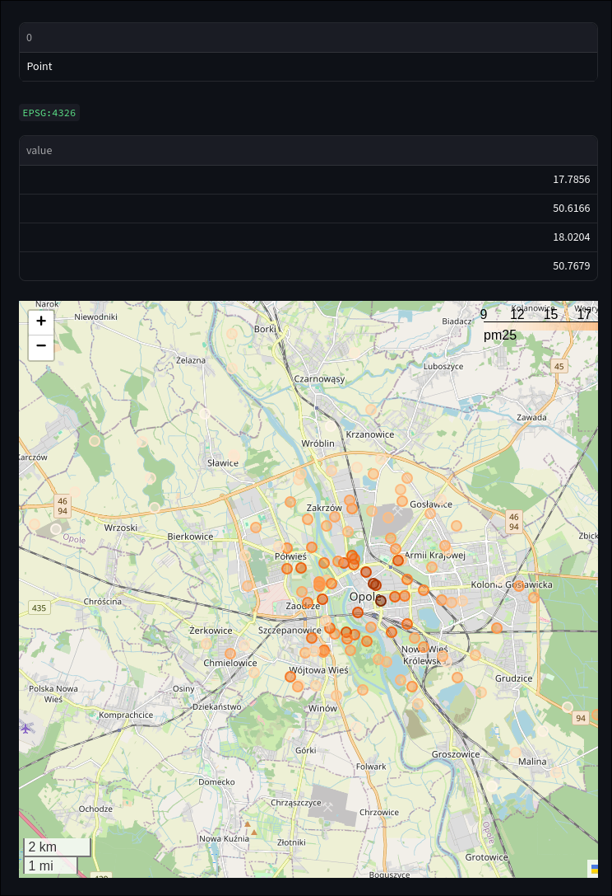

*Rys. 5. Czujniki PM2.5 na mapie*

> **Co się stanie po zamianie argumentów `points_from_xy(df["lat"], df["lon"])`?**
>
> Punkty trafiają na 50,7°E, 17,9°N, czyli do Jemenu, ok. 4 tys. km od Opola (Rys. 6). GeoPandas nie zgłasza błędu, bo obie liczby są poprawnymi współrzędnymi. Pomyłkę widać dopiero na mapie.

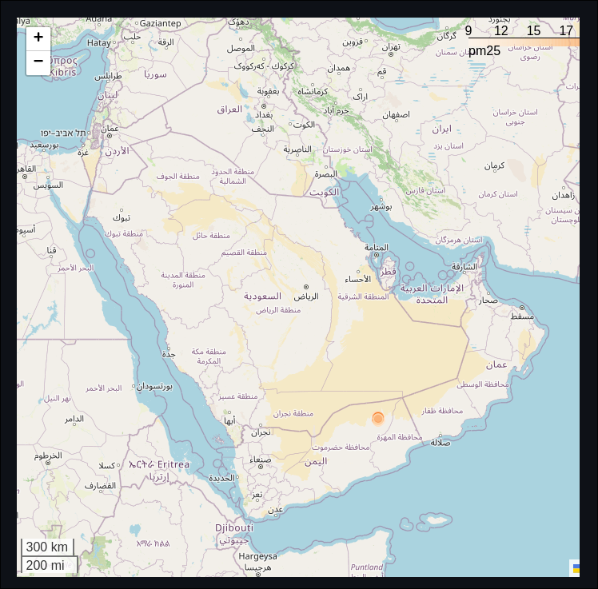

*Rys. 6. Czujniki po zamianie lat i lon*

### A5. Układy współrzędnych

Odległość między dwoma pierwszymi czujnikami w EPSG:4326 wynosi 0,0453°. Po `to_crs("EPSG:2180")` wynosi 4906 m.

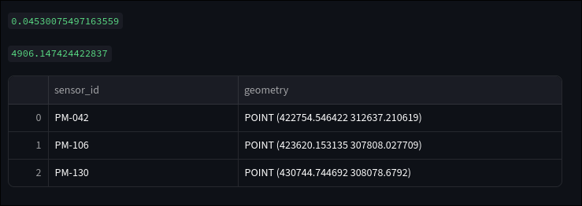

*Rys. 7. Odległość w stopniach i w metrach, współrzędne w EPSG:2180*

Na odcinku Gdańsk-Zakopane porównaliśmy oba układy metryczne z odległością geodezyjną (`pyproj.Geod`) [4]:

| Układ | Odległość [km] | Błąd |
|---|---|---|
| geodezyjna (WGS84) | 569,3 | - |
| EPSG:2180 (PUWG 1992) | 568,9 | -0,07% |
| EPSG:3857 (Web Mercator) | 922,8 | +62,09% |

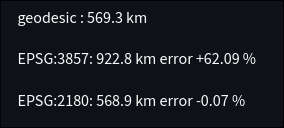

*Rys. 8. Porównanie układów*

Merkator wydłuża odległości o 1/cos(φ), dla 52° to ok. 1,62. Dane przechowujemy w EPSG:4326, liczymy w EPSG:2180, a EPSG:3857 zostawiamy do kafli mapy.

### A6. Dzielnice

Po `to_crs("EPSG:2180")` powierzchnia miasta wynosi 148,8 km². Największa dzielnica to Czarnowąsy (14,1 km²), najmniejsza Borki (0,66 km²).

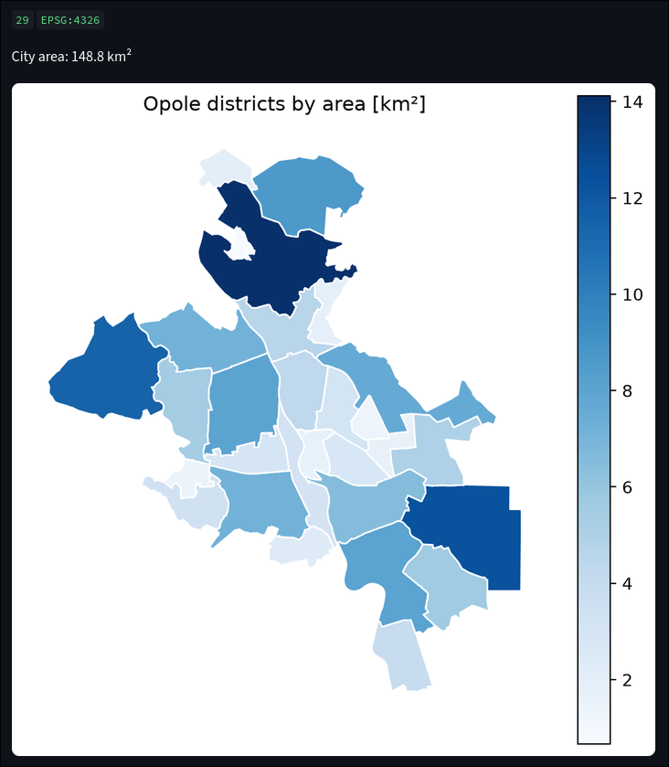

*Rys. 9. Dzielnice Opola według powierzchni*

> **Jaki wynik da `.area` bez `to_crs` i skąd ostrzeżenie?**
>
> Ok. 0,0189 "stopnia kwadratowego", po podzieleniu przez 1e6 wychodzi 0,0 km² (Rys. 10). Shapely liczy pole płasko w jednostkach współrzędnych. Stopień długości ma w Opolu ok. 70 km, a na równiku 111 km, więc stopnia kwadratowego nie da się przeliczyć na m² jednym mnożnikiem. GeoPandas wykrywa geograficzny CRS i zgłasza `UserWarning`.

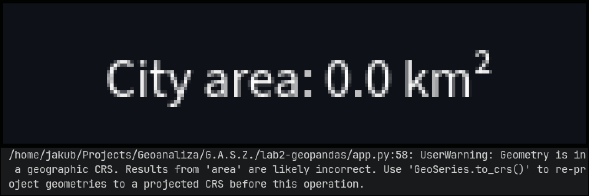

*Rys. 10. Pole liczone w EPSG:4326 i ostrzeżenie GeoPandas*

### A7. Złączenie przestrzenne

```python
joined = gpd.sjoin(sensors_m, districts[["name", "geometry"]], how="left", predicate="within")
stats = joined.groupby("name").agg(pm25_mean=("pm25", "mean"), sensor_count=("pm25", "size"))
reliable = districts.merge(stats, on="name").query("sensor_count >= 3")
```

Wszystkie 130 czujników trafiły do dzielnic, 3 dzielnice nie mają czujnika. Wśród dzielnic z co najmniej 3 czujnikami najgorzej wypadają Stare Miasto (29,6 µg/m³), Śródmieście (26,8) i Zaodrze (22,5).

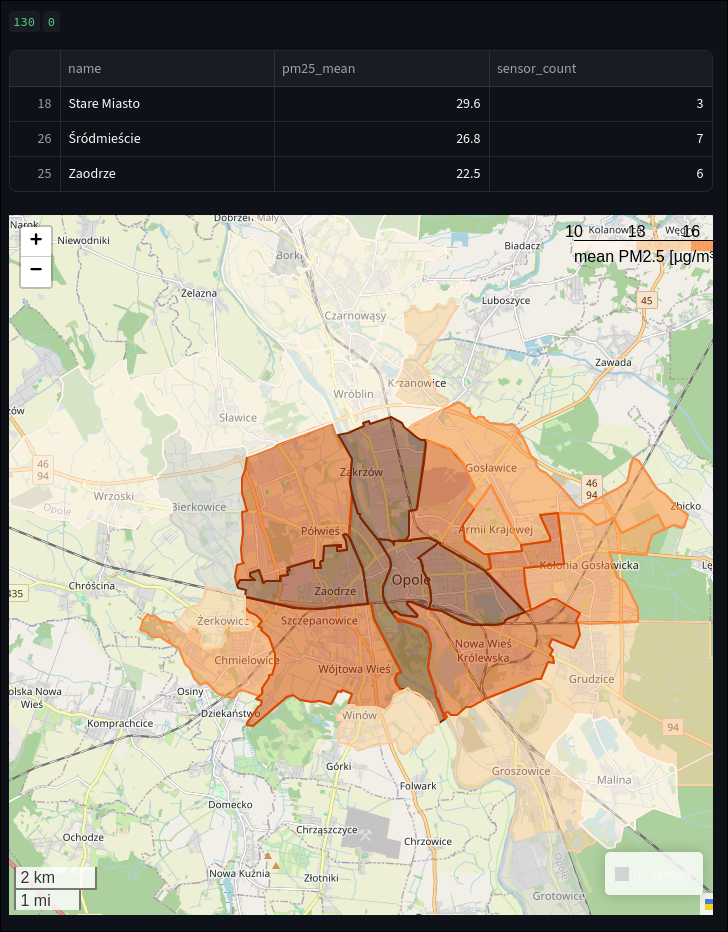

*Rys. 11. Ranking dzielnic i kartogram średniego PM2.5 (klasy kwantylowe)*

> **Czy `predicate="intersects"` zmienia wynik?**
>
> Nie, dla punktu wewnątrz poligonu oba predykaty dają to samo. Różnica pojawi się dla punktu dokładnie na granicy (`intersects` przypisze go do obu dzielnic) oraz dla linii i poligonów przecinających kilka dzielnic.

### A8. Bufory wokół szkół

Wokół 19 szkół zbudowaliśmy bufory 500 m w EPSG:2180 i złączyliśmy je z czujnikami. Pokrycie miasta liczyliśmy po `union_all()`, bo bufory nachodzą na siebie.

| Promień | Szkoły z czujnikiem | Śr. PM2.5 [µg/m³] | Pokrycie miasta |
|---|---|---|---|
| 500 m | 11 / 19 | 22,3 | 9,5% |
| 1500 m | 19 / 19 | 21,5 | 50,4% |

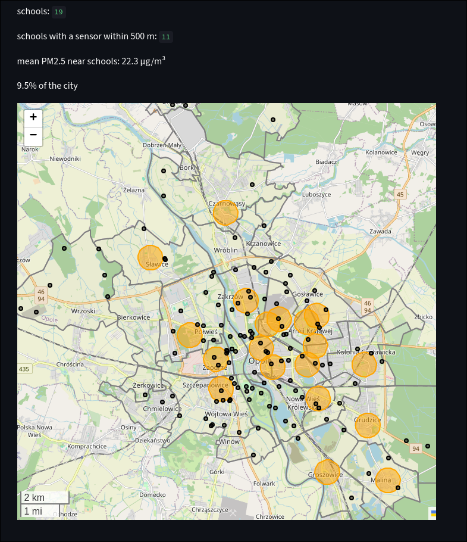

*Rys. 12. Bufory 500 m*

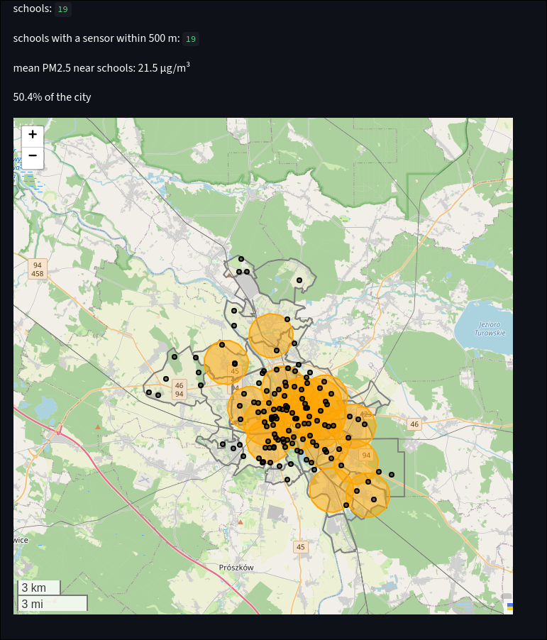

*Rys. 13. Bufory 1500 m*

> **Dlaczego `buffer(1500)` w EPSG:4326 byłby katastrofą?**
>
> Jednostką są stopnie, więc powstaje koło o promieniu 1500°. Obejmuje ono całą Ziemię wielokrotnie i każdy czujnik wpada w bufor każdej szkoły.

### A9. Zapis i weryfikacja w QGIS

Dzielnice i czujniki zapisaliśmy jako dwie warstwy w `wyniki/pm25.gpkg`, a dzielnice dodatkowo do GeoJSON w EPSG:4326. Odczyt kontrolny zwrócił 29 wierszy w EPSG:2180. W QGIS [5] obie warstwy pokrywają się z podkładem satelitarnym, więc CRS zapisał się poprawnie.


*Rys. 14. Odczyt kontrolny warstwy `districts`*

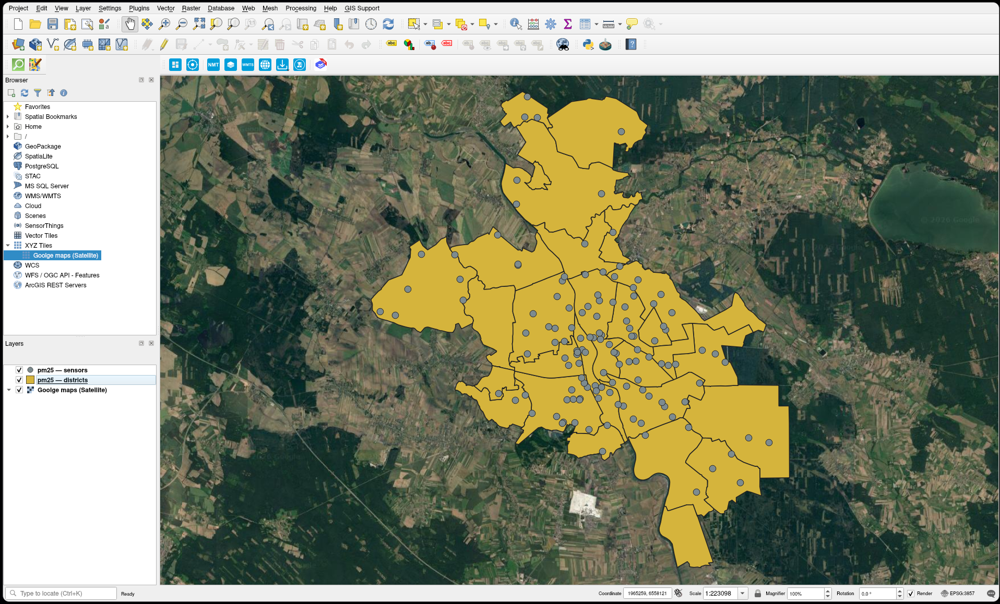

*Rys. 15. Warstwy z `pm25.gpkg` w QGIS*

## 4. Część B: Rasterio i NDVI

### B1. Metadane pasm

Oba pasma mają CRS EPSG:4326, 1717 wierszy × 2083 kolumn i typ float32, więc leżą na tej samej siatce. Piksel ma 9,0·10⁻⁵° w obu osiach. W Opolu to ok. 6,3 m w poziomie i 10 m w pionie, więc z pikseli w stopniach nie da się wprost policzyć powierzchni.

Wartości to współczynniki odbicia. B04 ma średnią 0,057, B08 0,201. Roślinność silnie odbija bliską podczerwień i pochłania czerwień, na tym opiera się NDVI. Poza zasięgiem sceny piksele mają wartość 0, a plik nie ma ustawionego `nodata`.

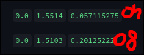

*Rys. 16. Min, max i średnia pasm B04 i B08*

### B2. Reprojekcja i NDVI

Oba pasma przeliczyliśmy na wspólną siatkę EPSG:2180 o oczku 10 m (natywna rozdzielczość B04 i B08):

```python
dst_transform, width, height = calculate_default_transform(
    red_src.crs, "EPSG:2180", red_src.width, red_src.height, *red_src.bounds, resolution=10)

def warp(src):
    out = np.full((height, width), np.nan, dtype="float32")
    reproject(source=rasterio.band(src, 1), destination=out, dst_transform=dst_transform,
              dst_crs="EPSG:2180", dst_nodata=np.nan, resampling=Resampling.bilinear)
    return np.ma.masked_invalid(out)

red, nir = warp(red_src), warp(nir_src)
with np.errstate(divide="ignore", invalid="ignore"):
    ndvi = np.ma.masked_invalid((nir - red) / (nir + red))
```

Tam, gdzie oba pasma mają 0, wychodzi 0/0 = NaN, a maska wyklucza te piksele z obliczeń. NDVI wynosi od -0,64 do 0,93, średnio 0,55.

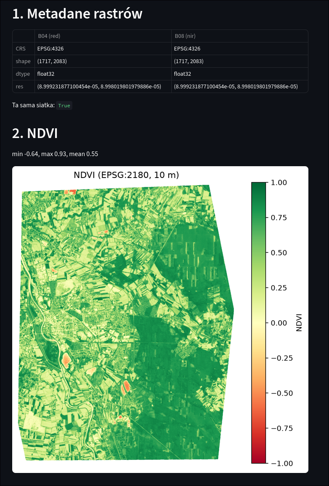

*Rys. 17. Metadane pasm i mapa NDVI w EPSG:2180*

### B3. Klasy NDVI

`np.digitize` z progami 0; 0,2; 0,5 dzieli piksele na 4 klasy. Piksel ma 100 m², więc powierzchnia klasy w ha to liczba pikseli · 100 / 10 000.

| Klasa | Powierzchnia [ha] | Udział |
|---|---|---|
| woda (< 0) | 178,8 | 0,8% |
| zabudowa, gleba (0-0,2) | 2478,6 | 11,7% |
| rzadka roślinność (0,2-0,5) | 5447,2 | 25,7% |
| gęsta roślinność (≥ 0,5) | 13053,8 | 61,7% |

Scena obejmuje 211,6 km². Ujemne NDVI mają głównie Odra i zbiorniki wodne.

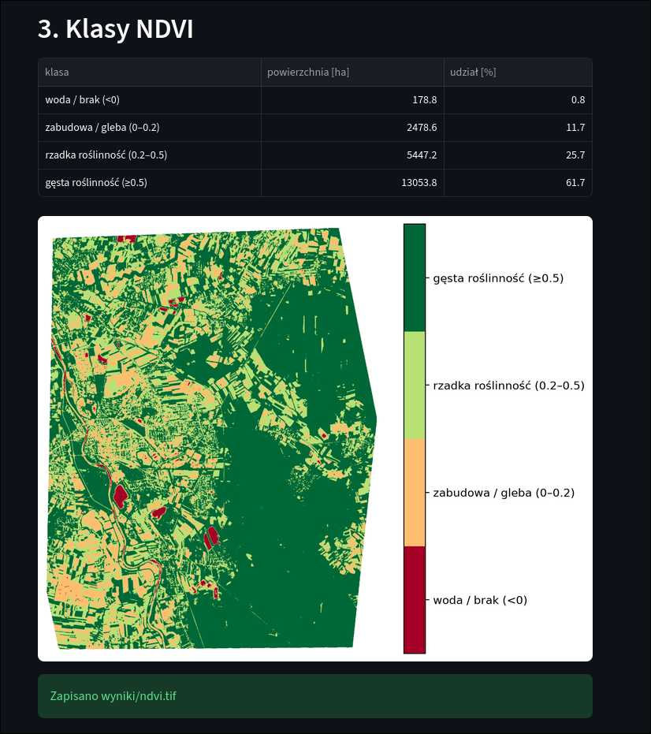

*Rys. 18. Klasy NDVI i ich powierzchnie*

### B4. Zapis GeoTIFF

Profil wzięliśmy z pliku B04 i nadpisaliśmy pola, które się zmieniły: CRS, transformację, wymiary, `dtype=float32`, `nodata=NaN` i kompresję deflate. Wynik to `wyniki/ndvi.tif`, 1736 wierszy × 1348 kolumn w EPSG:2180.

### B5. Średnie NDVI w dzielnicach

Dzielnice przeliczyliśmy do CRS rastra i dla każdej wycięliśmy piksele funkcją `rasterio.mask.mask`. Kolumna `coverage` to część dzielnicy pokryta sceną:

```python
clipped, _ = rasterio.mask.mask(src, [zone.geometry], crop=True, nodata=np.nan)
values = clipped[np.isfinite(clipped)]
coverage = values.size * pixel_area / zone.geometry.area
```

Scena zaczyna się na 17,895°E, więc 6 dzielnic po zachodniej stronie miasta (m.in. Bierkowice, Wrzoski, Żerkowice) leży poza nią. Sławice i Świerkle mają pokrycie poniżej 0,2%, więc ich wysokie NDVI pochodzi z kilku pikseli i nie nadaje się do porównań. `coverage` lekko powyżej 1 (Nadodrze, 1,001) wynika z tego, że piksel na krawędzi poligonu liczy się w całości, jeśli jego środek leży w środku.

Wśród dzielnic pokrytych w całości najwyższe NDVI mają Grudzice (0,717), Nadodrze (0,661) i Malina (0,539). Najniższe mają Stare Miasto (0,362), Śródmieście (0,370) i Chabry (0,391).

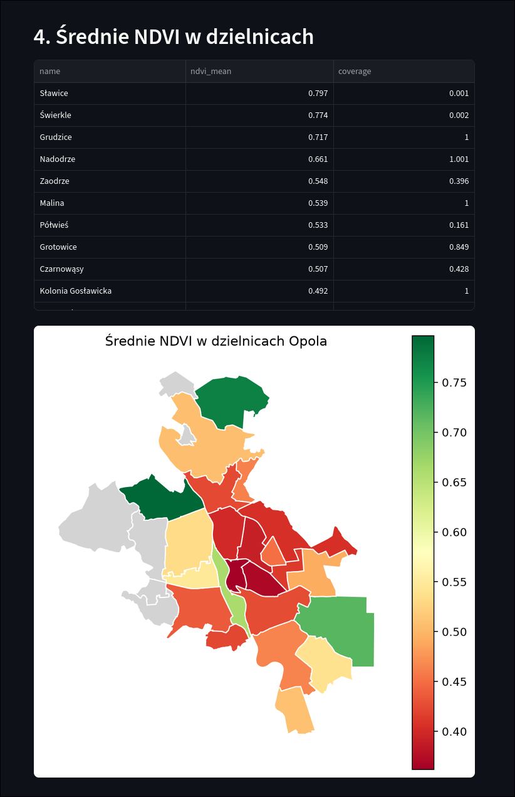

*Rys. 19. Średnie NDVI w dzielnicach (szare: poza sceną)*

Wynik zapisaliśmy do `wyniki/ndvi_districts.gpkg` i sprawdziliśmy w QGIS. Granice pokrywają się z podkładem.

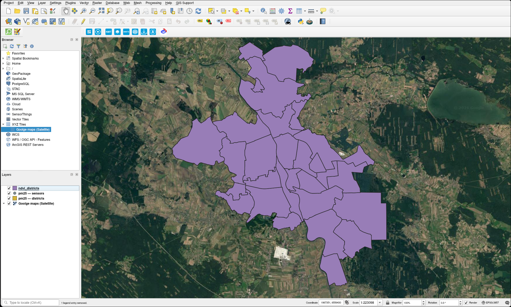

*Rys. 20. Warstwa `ndvi_districts` w QGIS*

## 5. Wnioski

- Wszystkie cztery błędy w CSV wyszły już w `describe()`, `isna()` i `duplicated()`. Ze 145 wierszy zostało 130.
- Najgroźniejsze błędy nie dają komunikatu. Zamiana lat i lon przenosi czujniki do Jemenu, a zamiana kolumn bez `.to_numpy()` nic nie robi. Wynik trzeba obejrzeć na mapie.
- Pola, odległości i bufory liczymy w EPSG:2180. EPSG:3857 zawyża odległości w Polsce o 62%. Dotyczy to też rastrów, bo piksel w stopniach ma w Opolu 6,3 × 10 m.
- Stare Miasto i Śródmieście mają najgorsze powietrze (29,6 i 26,8 µg/m³) i najniższe NDVI (0,36 i 0,37). Najmniej zieleni jest tam, gdzie PM2.5 jest najwyższe.
- Statystyki strefowe trzeba czytać razem z pokryciem sceną. Bez kolumny `coverage` Sławice wyszłyby jako najbardziej zielona dzielnica.

## 6. Bibliografia

1. GeoPandas, dokumentacja: <https://geopandas.org/en/stable/docs.html>, dostęp: 25.11.2026.
2. Rasterio, dokumentacja: <https://rasterio.readthedocs.io/en/stable/>, dostęp: 25.11.2026.
3. Streamlit, dokumentacja: <https://docs.streamlit.io/>, dostęp: 25.11.2026.
4. pyproj, Geod: <https://pyproj4.github.io/pyproj/stable/api/geod.html>, dostęp: 25.11.2026.
5. QGIS 3.44, dokumentacja: <https://docs.qgis.org/3.44/pl/docs/>, dostęp: 25.11.2026.
6. Sentinel-2, opis misji: <https://documentation.dataspace.copernicus.eu/Data/SentinelMissions/Sentinel2.html>, dostęp: 25.11.2026.
